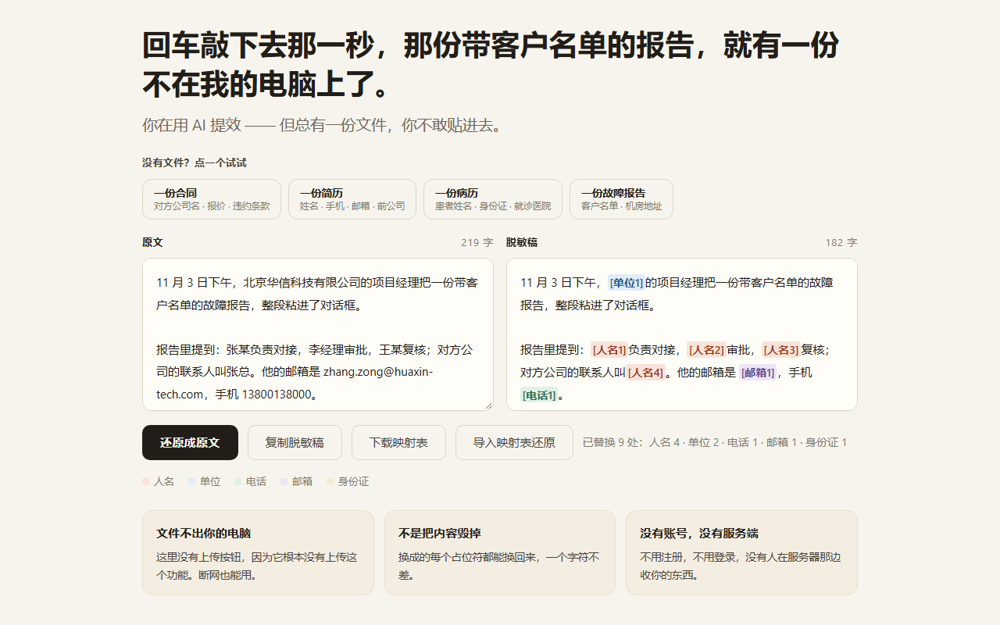

# 本地脱敏器

**把文件贴给 AI 之前，先把不该给的部分换掉。**

一个网页，双击就能用。没有上传按钮，因为它根本没有上传这个功能。

---

## 它解决什么

你把一份合同、一份简历、一份故障报告粘进 AI 对话框，换来一句「好的，我来分析」。

同一秒，那份文件就有一份不在你的电脑上了。

你可能会说：我用的是企业版、我开了不训练。

但真正的区别不在这里 —— **你做了这个动作，却没有停下来想过。**

这个工具让你先停一秒：在粘进去之前，把名字、公司、电话、邮箱、身份证换成一个方括号占位符。AI 照样能读懂结构，但它看到的是 `[人名1]`，不是陈默。

拿到 AI 的回答后，点一下「还原成原文」，占位符换回去。

**你只是要它答个问题，不是要它替你保管原件。**

---

## 三条：

| | |
|---|---|
| **文件不出你的电脑** | 打开 `index.html` 就能用。断网也能用。你可以拔了网线再试。 |
| **不是把内容毁掉** | 换成的每个占位符都能换回来，一个字符不差。 |
| **没有账号，没有服务端** | 不用注册，不用登录，没有人在服务器那边收你的东西。 |

---

## 怎么用

### 最快

下载 `index.html`，双击。

### 完整流程

1. 把原文粘进左边
2. 右边实时出脱敏稿
3. 点 **复制脱敏稿**，粘给 AI
4. 拿到 AI 的输出后，粘回左边
5. 点 **还原成原文**

### 跨天使用

点 **下载映射表**，得到一份 `redaction-map-*.json`，里面是「占位符 → 原文」的对照。

明天、下周、换台电脑，只要这两样还在 —— 映射表 + 脱敏稿 —— 点 **导入映射表还原**，就能换回原文。

映射表就是你唯一的钥匙。它不联网、不上传，也没法从别处恢复。**丢了就换不回来了。**

---

## 它能认什么

| 类型 | 例子 |
|---|---|
| 人名 | `张三丰` `李四` `王小明` `张总` `李经理` `王某` |
| 单位 | `北京华信科技有限公司` |
| 电话 | `13800138000` |
| 邮箱 | `zhang.zong@huaxin-tech.com` |
| 身份证 | 18 位 |

---

## 它认不出什么（这一节比上面重要）

**这个工具基于规则，不做语义理解。**

- **全名要有一道边界**：名字后面必须跟标点、空格，或「负责 / 审批 / 记录」这类词；前面必须是句首、标点，或「由 / 和 / 叫 / 会后」这类引导词。所以「他喊周涛过来」这种两头都是动词的写法，认不出来。
- **反例一律不动**：「张江」「李庄」是地名，「陈设」「张开」「李子」是普通词，「高德地图」「王的盛宴」是专有名词，都在黑名单里 —— 这些一个都不许被误认成人名。
- **地址不动**：宁可漏，不猜错。
- **英文名、微信昵称不动。**

**设计取向是「宁可漏，不猜错」。**

误伤比漏认更伤 —— 你把一段正常文字贴进来，结果「陈设」被当成名字，你就再也不会信这个工具了。

所以：**贴进去之后，自己扫一眼右边。** 工具帮你挡掉大部分，最后一眼得你自己看。

---

## 技术细节

- **单文件**：一个 `index.html`，HTML + CSS + JS 全在里面
- **零网络请求**：`CSP: default-src 'none'`，14 项正则扫描（`http(s)://`、`fetch(`、`XMLHttpRequest`、`WebSocket`、`sendBeacon`、`<iframe>`…）0 命中
- **无依赖**：不加载任何外部资源，字体用系统自带的
- **导出**：`Blob` + 临时对象地址，不经过任何服务
- **导入**：`FileReader` 本地读取
- **自测**：`selftest.js` 从页面里原样抽出引擎代码执行，17 项加 v4 功能 20 项全过。跑 `node selftest.js`

---

## 许可

MIT
